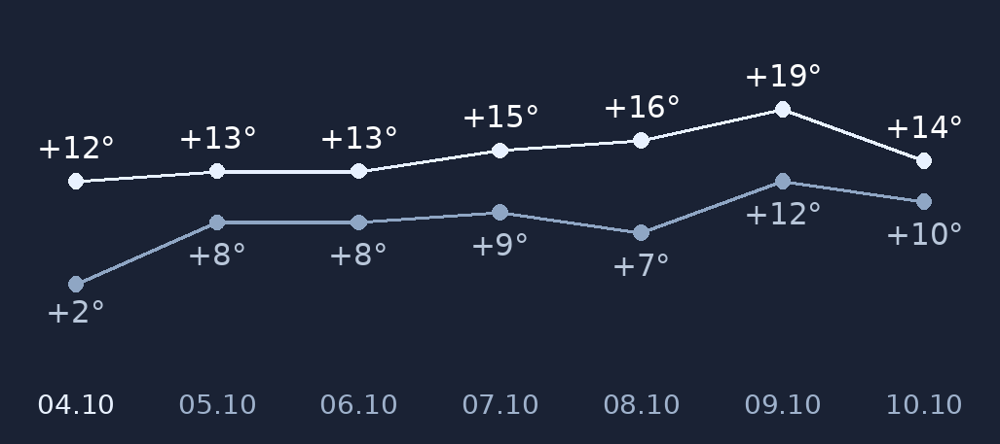
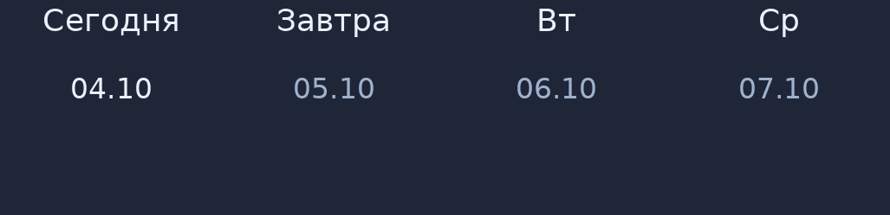

# 🌤 Погода — виджет для Android, который собирается без Gradle

Виджет погоды в стиле «Яндекс.Погоды» (часы слева, погода справа, подробное окно с почасовкой и 7 днями)
для любого Android 6.0+, который **собирается вручную на ARM-плате** — там, где официальный Android SDK
и Gradle не запускаются.

**Схема работы:**
```
┌──────────────────────────────┐          ┌───────────────────────────┐
│  Android-телефон             │  HTTPS   │  open-meteo.com           │
│  ┌────────────────────────┐  │ ───────► │   • прогноз (почасовой,   │
│  │ виджет 5×1             │  │          │     7 дней)               │
│  │  часы │ иконка+темп.   │  │ ◄─────── │   • справочник городов    │
│  └────────────────────────┘  │   JSON   └───────────────────────────┘
│  тап по времени → часы ОС    │
│  тап по погоде → подробности │
└──────────────────────────────┘
```

Что внутри: виджет 5×1 (часы + иконка погоды + дневная и ночная температура), подробное окно
(крупная температура, лента по часам каждый час с восходом и закатом, 7 дней с графиком максимумов
и минимумов — под каждой точкой дата в формате `04.10`) и выбор любого города России.

---

## Почему так, а не иначе?

Собирать Android-приложение «нормально» (Android Studio + Gradle) на ARM-плате не получается:
в официальном SDK утилита `aapt2` идёт только под x86-64, а ARM-сборок Google не публикует.
Поэтому наш путь — **собрать пакет вручную теми инструментами, которые на ARM есть**:
`aapt2` для ARM из Debian, платформа `android.jar`, `d8` и `apksigner` (это java-архивы, работают
на любой архитектуре). Результат — обычный подписанный APK, который ставится как любой другой.

Остальные грабли, на которые мы наступили и которые учтены в проекте:

1. **Источник данных.** Начали с `wttr.in`: он отдаёт шаг 3 часа и только 3 дня.
   Нужен был «каждый час и 7 дней» — перешли на **Open-Meteo** (бесплатно, без ключа, почасовой
   прогноз и 7 дней), справочник городов — тоже у них.
2. **Установка на Huawei/HarmonyOS.** APK с `targetSdkVersion=34` система отказывалась ставить:
   «недействительный пакет, несовместимо с системой». Помогло снижение до **31** (уровень самой
   системы) и установка не через старый файловый менеджер, а через штатный «Файлы» или прямо из мессенджера.
3. **Тап по времени и «чужие» приложения.** Начиная с Android 11 приложение не видит другие программы
   без элемента `<queries>` в манифесте — из-за этого системные часы «не находились». Теперь в манифесте
   объявлены нужные интенты, а само приложение ищет часы среди установленных (по имени пакета,
   класса и подписи) и только потом откатывается на системный вызов «показать будильники».
4. **Иконка.** Для адаптивных иконок (Android 8+) нельзя увеличивать рисунок: маска системы обрезает
   края, и композиция «вылезает». Рисунок кладётся ровно по холсту 108×108 dp, а обычные значки
   (48…192 px) получаются с прозрачным фоном — без белой подложки вокруг плитки.
5. **Часы в виджете.** Использован `TextClock` — он тикает сам, без будильников и служб, поэтому
   виджет не будит телефон каждую минуту.

---

## Что понадобится

- **Телефон** на Android 6.0+ (проверено на Huawei с HarmonyOS);
- **JDK 17+** (в Debian: `sudo apt install openjdk-17-jdk-headless`) — там же `javac` и `keytool`;
- **aapt2 для ARM** — пакет `android-sdk-build-tools` (даёт `/usr/bin/aapt2`);
- **платформа и build-tools** от Google (около 120 МБ): `platform-34-ext7_r03.zip` и
  `build-tools_r34-linux.zip` — из них берутся `android.jar`, `d8.jar`, `apksigner.jar`;
- **python3 + Pillow** — только если хотите сами нарезать иконку из картинки;
- (необязательно) **ключ MiniMax** — если хотите сгенерировать картинку иконки через ИИ.

---

## Часть 1. Ставим инструменты сборки

```bash
sudo apt update
sudo apt install -y openjdk-17-jdk-headless android-sdk-build-tools unzip python3-pil

mkdir -p "$HOME/android-sdk" && cd "$HOME/android-sdk"
curl -LO https://dl.google.com/android/repository/platform-34-ext7_r03.zip
curl -LO https://dl.google.com/android/repository/build-tools_r34-linux.zip
unzip -q platform-34-ext7_r03.zip
unzip -q build-tools_r34-linux.zip

# проверка: сборщик ресурсов, компилятор и java-архивы на месте
aapt2 version
javac -version
ls android-34/android.jar android-14/lib/d8.jar android-14/lib/apksigner.jar
```

**Что тут важно:**
- `aapt2` из Debian — **ARM-сборка**, именно она делает этот путь возможным;
- `d8.jar` и `apksigner.jar` — обычные java-архивы: они запускаются на ARM через `java -cp`.

---

## Часть 2. Собираем APK

```bash
ANDROID_SDK="$HOME/android-sdk" ./scripts/build-apk.sh
```

Скрипт делает шесть шагов: ресурсы → линковка с манифестом и `R.java` → компиляция Java →
`.dex` → упаковка кода в пакет → подпись (ключ создаётся автоматически, если его нет).

**Про ключ подписи.** Ключ должен лежать **вне** каталога сборки: сборка начинается с очистки `build/`,
и ключ, положенный туда, стирается вместе с ней — каждая сборка получает новый ключ, а APK перестаёт
ставиться поверх предыдущего (`INSTALL_FAILED_UPDATE_INCOMPATIBLE`). Скрипт по умолчанию держит ключ
в `~/.android-weather-widget/keystore.jks`, адрес можно переопределить переменной `KS`.

**Проверка результата:**

```bash
# подпись и её схемы (v1/v2/v3)
java -jar "$HOME/android-sdk/android-14/lib/apksigner.jar" verify -v build/weather-widget.apk

# что внутри: имя пакета, версия, минимальная и целевая версия системы, значок
aapt2 dump badging build/weather-widget.apk | head -5
```

---

## Часть 3. Устанавливаем и добавляем виджет

1. Перекиньте APK на телефон (мессенджер, облако, кабель — как удобно).
2. Откройте файл **штатным «Файлами»** или прямо из мессенджера и разрешите установку
   из этого источника.
3. Долгое нажатие на свободном месте рабочего стола → **«Виджеты»** → **«Погода»** → перетащите
   на экран (занимает 5 клеток в ширину, 1 в высоту).

**Как пользоваться:**
- тап по **времени** → открываются часы телефона;
- тап по **погоде** (иконка, температура) → подробное окно;
- тап по **дате или стрелке** → обновить прогноз вручную;
- три точки в подробном окне → **«Выбрать город»**.

**Как читать график:** верхняя линия — дневной максимум, нижняя — ночной минимум; одна точка — один день, под точкой дата в формате `04.10` (сегодняшняя светлее остальных). Порядок слева направо: от сегодня к седьмому дню.





---

## Часть 4. Своя иконка (необязательно)

```bash
# 1) картинка через MiniMax (нужен свой ключ)
MINIMAX_API_KEY=... python3 scripts/generate-icon.py --out icons

# 2) нарезка под Android: значки всех плотностей + адаптивная иконка + превью
python3 scripts/make-launcher-icons.py icons/icon_a.png app/res
```

Скрипт сам уберёт белые поля и мягкую тень, определит цвет плитки, сделает прозрачный фон
у обычных значков и соберёт `icon-preview.png` — как это будет выглядеть на светлом и тёмном фоне.

---

## Как это устроено

Коротко: виджет — `AppWidgetProvider` с разметкой на `RemoteViews` (часы — `TextClock`, он тикает сам),
прогноз тянет фоновый поток из Open-Meteo и кэширует JSON в настройках приложения,
поэтому без сети виджет показывает последние загруженные данные, а не пустоту.

Подробнее про классы и поля прогноза — в [docs/architecture.md](docs/architecture.md).

---

## Частые проблемы

| Проблема | Решение |
|---|---|
| «Недействительный пакет», «несовместимо с системой» | Соберите с `targetSdkVersion=31` и ставьте через штатный «Файлы» или мессенджер. Старые файловые менеджеры (например, ES Проводник) ломают установку на Android 11+ |
| APK не ставится поверх старой версии | Подписи не совпадают — сборка подписана другим ключом. Соберите тем же ключом (`KS=...`) и держите ключ вне очищаемого каталога сборки: см. «Часть 2» |
| Виджета нет в списке | Переустановите APK и подождите минуту: лаунчер обновляет список виджетов с задержкой |
| Тап по времени ничего не открывает | Приложению нужно видеть часы системы — в манифесте должен быть `<queries>` с `SHOW_ALARMS`; в проекте он есть, а поиск идёт по имени пакета, класса и подписи |
| Иконка обрезана или «увеличена» | Для адаптивной иконки рисунок должен идти ровно по холсту 108×108 dp без увеличения, иначе маска системы режет края |
| Погода не грузится | Open-Meteo доступен не из всех сетей: проверьте, что телефон открывает `api.open-meteo.com`; часть регионов требует VPN. Без сети виджет покажет последний сохранённый прогноз |
| Часы в виджете отстают | Виджет обновляет погоду раз в 30 минут, а время тикает само через `TextClock`; если время замерло — проверьте, не «усыпил» ли виджет режим энергосбережения |

---

## Переименовать приложение

Название задаётся в `app/res/values/strings.xml` (`app_name`) — поменяйте строку и пересоберите.
Имя самого виджета — там же, в `widget_name`.

---

## Альтернативы

- **Android Studio + Gradle на x86-компьютере** — привычный путь, если под рукой обычный ПК;
- **GitHub Actions** — сборка в облаке (там x86): удобно, если нужен APK, а платформа ARM;
- **Любая другая точка входа в данные** — вместо Open-Meteo можно взять `wttr.in` (шаг 3 часа, 3 дня)
  или любой другой сервис: достаточно поменять разбор ответа в одном классе.

---

## Полезные ссылки

- Open-Meteo — прогноз: <https://open-meteo.com/en/docs>
- Open-Meteo — справочник городов (геокодинг): <https://open-meteo.com/en/docs/geocoding-api>
- Виджеты Android: <https://developer.android.com/develop/ui/views/appwidgets>
- `RemoteViews` и что в них допустимо: <https://developer.android.com/reference/android/widget/RemoteViews>
- d8/R8 (сборка `.dex`): <https://developer.android.com/build/releases/d8>
- MiniMax image-01 (генерация картинок): <https://platform.minimaxi.com/document/Image%20Generation>

## Лицензия

MIT — делай что хочешь, но без гарантий 🙂
